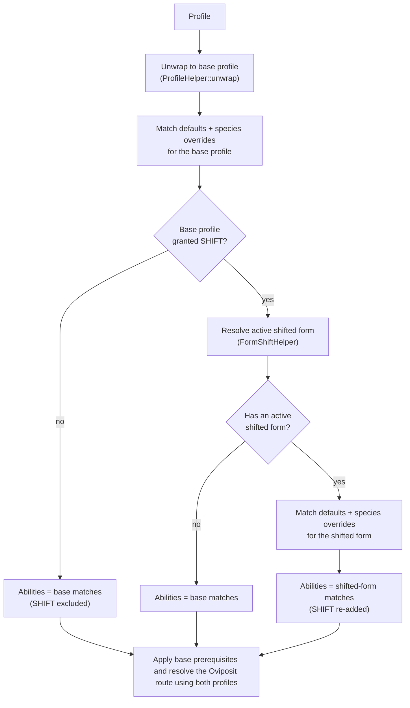

# Abilities

## For end-users

### What abilities are

An ability is a special action a character can take beyond the usual
menu-driven scenes, offered from **MyProfile → Abilities** in-world (and
mirrored on the [dashboard](companion-dashboard.md)'s Abilities panel).
Access to a species ability requires at least **40% ancestry from the species
granting it** and a matching form and class. Purebred species owners can assign an
ability on the dashboard under **Character → Species → Species abilities**.
Choose the ability and each eligible form/class combination, then select
**Assign permanently**. Both the ability and its combinations are permanent.
Oviposit requires the species’ **Embryo type** to be **Ovum** before assignment.
Assigning Oviposit directly locks that setting in the dashboard and HUD. A
hybrid that inherits Oviposit can choose **Live** or **Ovum** at creation and
change it later. With Live births, the Species page lists the inherited ability
as requiring Ovum births. Switching to Ovum lets qualifying characters use
it again. Either birth type can pass the granting ancestry on to descendants.
An older direct assignment with Live births can be corrected to Ovum.

An assignment uses one slot however many combinations it covers. Inherited
abilities use no slots. The Species page lists grants from the species recipe.
The Abilities page uses your character's own inherited shares. If your
character doesn't currently qualify for an ability, the in-world menu won't
offer it; the dashboard can list it as unavailable.

The abilities available today:

| Ability | What it does |
|---|---|
| **Transmute (Shift)** | Change between forms you've learned. See [Form Shapeshifters](form-shapeshifters.md) for what shifting actually changes about your character. |
| **Oviposit** | Deposit a chosen number of your ova, or eligible pregnancies, into an available orifice of a character within 5 metres. |
| **Bite** | Bite a nearby character (within about 10 metres), draining a small amount of their health and defense and sampling a taste of their blood. |

### Using Oviposit

Choose a nearby character, wait for their HUD to report available orifices, then
choose an orifice, what to deposit, and a whole-number quantity. The web panel
keeps these choices together; the native HUD offers the same controls.

Characters appear in the search within 10 metres. When you submit a deposit,
your HUD scans for the selected character within 5 metres.

- Your true form must have a vagina and your true species must have Ovum births.
  In your true form you also need the ability from your own species. The
  [Oviposit rules for each form](oviposit-rules.md) explain how a shapeshifter
  can use a grant from either species and which anatomy they use.
- You can deposit only unfertilized eggs you produced and still carry, or
  pregnancies that you conceived, still carry, and are at most 30% complete.
  Oviposit cannot pass on an egg that another character deposited into you.
- Ova and pregnancies have separate counts and an explicit choice, so choosing
  ova never substitutes an active pregnancy. Oldest eligible entries go first.
- Covered, occupied, and nonexistent orifices are excluded. The receiving HUD
  checks again before transferring the full selected quantity. A stale or timed
  out request transfers nothing; refresh and try again.
- Transfers preserve the original parents, inherited traits, and creation or
  conception date. The selected orifice determines the receiving incubator,
  including the usual biology routing for a shifted recipient.
- Each deposited egg (including an eligible pregnancy) lowers the recipient's
  defense by 10 percentage points and raises arousal by 5 percentage points,
  bounded by the usual stat limits. The normal arousal reaction runs first;
  a separate defense stat invoker applies any remaining loss needed to reach
  10 percentage points per egg.
- Every completed deposit checks stretch at the recipient’s mouth, anus, or
  vagina. Each egg starts with the donor’s base-species embryo volume in ml.
  A fertilized egg adds the offspring species’ maximum embryo volume multiplied
  by the fraction of gestation completed at transfer. The game converts each
  egg’s total volume to a diameter in mm and divides it by the entry opening’s
  width. A shifted vaginal deposit routed to the colon uses the anal width.
  Vitality loss starts at twice the opening’s width. At 2, 3, 4 and 5 times the width,
  each egg takes 10%, 20%, 40% and 80% of **remaining** vitality, respectively.
  Whole multiples set the threshold; 6 times or more caps at 100%. These effects
  use `RolePlayService::affectStatBy` with the orifice-overstretch cause.
- After a successful transfer, the recipient's own HUD emits an anonymous
  whisper about feeling something enter the selected orifice, like the Ovum
  Exchanger. It does not name the donor. The donor's own HUD and web result
  confirm the deposited egg count and selected orifice.
- Failed transfers have no stat effects or success notices. Replayed deposit
  messages cannot apply effects or emit recipient notices again.

### Using Bite

Choose **Bite** from the Abilities menu (or the dashboard's Abilities panel),
then pick a character within range from the list offered — only characters
seen nearby recently are listed. Biting them:

- Lowers the target's vitality (health) by 5 percentage points and defense by
  10 percentage points, without taking either below zero. For example, 60%
  health becomes 55%.
- Gives you a small taste of their blood, described by its flavor.
- Notifies the target that they were bitten and what they lost.

If the character you picked has moved out of range or stopped being available
since the menu opened, you'll be asked to search again rather than the bite
silently failing or landing on the wrong person.

If no targets appear in the browser, keep your companion worn and let it update
your location before searching again; both you and the target need recent
in-world activity.

### Things to keep in mind

- A grandchild with 25% Fox ancestry falls below the threshold for a Fox
  ability, even if their selected species is Fox. A character with exactly
  40% Fox ancestry qualifies when their form and class match a Fox rule.
- Shift's availability doesn't necessarily mean you already have any
  particular alternate form learned — that's a separate matter of which
  disguises you've picked up (see [Form Shapeshifters](form-shapeshifters.md)).

---

## For developers

### `AbilityTypeEnum`

`AbilityTypeEnum` (`src/classes/enums/AbilityTypeEnum.php`) is the closed set
of abilities: `SHIFT` (`ability.shift`, displayed as "Transmute") and `BITE`
(`ability.bite`, displayed as "Bite"), plus `OVIPOSIT` (`ability.oviposit`). Each case carries its own
`toValue()` display label, `getDescription()` player-facing blurb, and
`getApiHandle()` — the name of the helper class that serves that ability's
own detail surface on the dashboard (`AbilityShiftHelper` /
`AbilityBiteHelper`), used so a generic client can route a selected ability to
the right panel without a hardcoded switch. Adding a new ability means adding
a case here plus its own helper/dialog pair (see Extension points, below).

### Two-layer grant model

Two database tables determine eligibility. Administrators configure general
defaults. Eligible species owners can also add permanent species overrides through
the dashboard. See `ddl/Abilities.sql` and `ddl/SpeciesAbilities.sql`.

| Table / entity | Selector columns | Meaning |
|---|---|---|
| `ane_abilities` / `AbilityModelImpl` (`AbilityRepository`) | `ability`, optional `form`, optional `class` | A **species-independent default** grant: any profile whose form/class matches (a `null` selector matches anything) gets the ability, *unless* a species override exists for that ability (see below). |
| `ane_species_abilities` / `SpeciesAbilityModelImpl` (`SpeciesAbilityRepository`) | `species`, `ability`, optional `form`, optional `class` | A species grant. Each qualifying source contributes its own set of eligible form/class combinations. |

Both tables generate a stored `scope` column (`form:class`, or
`species:form:class`) purely to carry a database-level uniqueness constraint
across wildcard (`NULL`) combinations — `uniq_ability_scope` /
`uniq_species_ability_scope` — alongside a plain-column uniqueness constraint,
so two rules can't be inserted for the same effective scope by mistake, even
via a direct SQL write.

A founder or parentless character uses its species recipe. Descendants inherit
their parents' actual contributions using the same weights as the ancestry
view. Shares from multiple paths to the same species add together. Each
granting species must independently reach 40% before its rules can apply.
For example, 35% Fox and 35% Wolf qualify for neither source's Bite grant.

For a grant defined directly on a named hybrid, the source is the contribution
from that hybrid in the recipe or pedigree. A branch with 50% Foxwolf passes
50% Foxwolf and its weighted Fox and Wolf ingredients. A Foxwolf label on a
descendant adds no share. These overlapping source shares are used only for
ability checks. The ordinary ancestry breakdown still totals 100%.

A matching rule from any qualifying source grants the ability. Each row's form
and class must match together. A rule belonging to the named species or any
qualifying source supersedes the general default for that ability across all
forms and classes. This also preserves the named species override when the
individual falls below the ancestry threshold.

### Resolving eligibility (`SpeciesAbilityHelper`)

`SpeciesAbilityHelper` (`src/classes/helpers/SpeciesAbilityHelper.php`) is the
single place both the in-world dialog and the dashboard route through:

- `fetchAbilities(ProfileModel $profile): AbilityTypeEnum[]` — the profile's
  granted abilities whose base-profile prerequisites are satisfied.
- `hasAbility(ProfileModel $profile, AbilityTypeEnum $ability): bool` — a
  single-ability check.

Ordinary grants follow the worn species, form and class. Oviposit also considers
the true profile's grant. Its base prerequisites are Ovum births and a vagina.
The resolver first checks for a worn grant and a vagina on the worn form. If
that route is unavailable, an active shifted form with a penis can use a true
profile grant. The HUD menu, web overview and deposit endpoints share this
decision. The receiver resolves the sender again when processing the transfer
and records the source anatomy in the completed exchange result.

Shift itself is always evaluated against the **base** profile: changing form
can never remove your own ability to change back. `hasAbility()` special-cases
`SHIFT` to skip the "does the currently-worn disguise still resolve" check
that `fetchAbilities()` performs for other abilities, so a stale/invalid saved
disguise never blocks shifting back.

`fetchMatchingAbilities()` resolves the qualifying source IDs once for each
appearance. It merges matching source rules with the remaining general
defaults and returns distinct abilities ordered by key. Both raw appearances
and public region pings use the worn form's pedigree. Shift authorization uses
the base character's pedigree.

### Dashboard surface

- **`AbilityHelper`** (`/api?class=AbilityHelper`) — lists every
  `AbilityTypeEnum` case with its label, description, `handle` (the detail
  helper's class name), and whether the active profile currently has it
  (`SpeciesAbilityHelper::fetchAbilities()`). This is the web equivalent of
  the in-world **MyProfile → Abilities** menu (`ProfileAbilitiesDialog`).
- **`AbilityShiftHelper`** (`/api?class=AbilityShiftHelper`) — the Shift
  ability's own detail surface (learned forms, current form, switching).
  Availability now checks `SpeciesAbilityHelper::hasAbility(..., SHIFT)`
  instead of the old hardcoded "is this profile's form
  `FormTypeEnum::FORM_SHIFT`" check; `RolePlayService::doShift()` (the
  in-world shift action itself) was changed the same way, so both surfaces
  agree on eligibility.
- **`AbilityBiteHelper`** (`/api?class=AbilityBiteHelper`, and subscribed as
  an `InteractionSubscriber` for the cross-account notification) — see below.

### Bite mechanics (`AbilityBiteHelper`)

`AbilityBiteHelper` (`src/classes/helpers/AbilityBiteHelper.php`):

1. `fetchTargets()` — returns active, unblocked characters seen in the region
   within the last 5 minutes (`RECENT_INTERVAL`) and within 10 metres
   (`RANGE_METERS`) of the biter, via
   `HeaderHelper::fetchAccountsInRegionAfter()` filtered through
   `AccountBlockHelper`. Used by both the in-world `BiteAbilityDialog` target
   picker and the dashboard's target list.
2. `bite(string $targetKey, string $expectedProfileId)` — re-checks
   eligibility, range, and that the selected target still matches the
   expected profile id (so a stale menu can't bite whoever happens to occupy
   that slot now), then in one transaction: deposits 1ml of the target's
   actual blood snapshot through the biter's mouth into the stomach
   (`FluidsHelper::persistFluid()`, see
   [Reproduction & Genetics Lifecycle](reproduction-and-genetics.md)), and
   reduces the target's vitality by 5 percentage points and defense by 10
   percentage points, clamped at zero
   (`StatsHelper::adjustStatByPercent()`, see [Vitality & Stats](vitality-and-stats.md)).
   The blood's flavor is read back for the biter's confirmation message.
3. The bite is announced to the target via
   `InteractionService::outputTarget()` (`ACTION_BITTEN`); `on_action()`
   (the `InteractionSubscriber` handler, registered alongside every state in
   `AbstractAneState::on_initialized()`/`on_state_leave()`) only narrates the
   notification on the receiving session — it never re-applies effects, since
   the sender's transaction already committed them, which protects against a
   redelivered interaction re-biting the same target.
4. `on_api()` mirrors the same flow for the dashboard: `GET` reports
   availability + targets (`key`, `profileId`, `label`), `POST` (`target`,
   `profileId`) performs the bite and returns `ok` plus a message or error.

Target lookup also rejects an origin header older than five minutes or missing
its region/local position. The framework installs the owner's stored HUD headers
for web requests; browser-supplied location is not a replacement for recent
in-world presence. The same check applies when submitting the selection.

Blood persistence and stat changes share one transaction, so a failed fluid
write rolls back both actors' database effects. Notification follows the commit.
`FluidSnapshotModelImpl` (`src/classes/models/FluidSnapshotModelImpl.php`) reads
the character UUID from `fs_detail.profile`; new snapshots leave the deprecated
integer `fs_profile_id` null. `FluidsHelper` uses the supplied victim profile for
fluid ownership and identity rather than the current request's biter.

In-world, `ProfileAbilitiesDialog` lists only the abilities
`SpeciesAbilityHelper::fetchAbilities()` currently returns for the active
profile and routes `ability.bite` to `BiteAbilityDialog` (the target picker)
and `ability.shift` to `ShiftAbilityDialog`.

### Ability use history

The backend writes one row to `ane_ability_event` in the transaction that
changes the form, applies the bite, or transfers the full Oviposit batch. The
event stores the ability key, UTC time, and the profile ID and Second Life
owner key of each participant at that time. Those IDs survive profile transfers,
deletions, and expiry of the Oviposit exchange. Shift uses the character as
both actor and target.

`ae_origin` identifies the initiating entry point (`web`, `hud`, or
`backend` for direct service calls). The receiving HUD preserves the origin
of an Oviposit exchange. `ae_metadata` holds the parameters and results as JSON.

| Ability | Recorded parameters and results |
| --- | --- |
| Shift | Previous and new form IDs (null for the base form) and strength cost |
| Bite | Blood volume in ml, blood snapshot ID, and the target’s remaining vitality and defense as fractions |
| Oviposit | Exchange ID, kind, quantity, orifice, resolved incubator, mechanism, transferred egg IDs, and vitality loss as a fraction |

Apply [the ability event migration](../ddl/AbilityEvent.sql) before deploying
the PHP change. New abilities should persist an `AbilityEventModelImpl` inside
their successful action transaction.

### Grant persistence and deployment

The grant entities live under `src/classes/models/`; the repositories under
`src/classes/repos/` implement the matching rules above. The species foreign
key identifies the granting ancestor. Deleting that species cascades to its
own stored overrides.

Both grant entities construct UUID v4 primary keys (`ab_id` and `sa_id`, mapped
as Doctrine `guid`). Direct SQL inserts must supply those UUIDs. The generated
scope columns normalize null selectors to `*` and separate selector values with
`:`, so future selector values must not contain either reserved character.
PostgreSQL and the SQLite test harness use the same generated expressions.

Deploy the schema before code that reads these tables. For a fresh installation,
review and apply `ddl/Abilities.sql` and `ddl/SpeciesAbilities.sql`; the existing
`php bin/doctrine ddl:sync --dump-sql` command previews mapped schema changes.
Do not run the fresh CREATE statements on existing tables. An older integer-ID
installation needs new UUIDs for existing rows and removal of its integer
default/sequence; integer values cannot simply be cast to UUIDs.

Neither lookup nor deployment seeds grants: empty tables mean no abilities,
including Shift and Bite. Configure the intended rules explicitly. Persist
`AbilityModelImpl` for defaults or `SpeciesAbilityModelImpl` for an override,
with optional form/class selectors and a required species for the latter.
The owner action on `MyCharacterHelper` accepts an ability key and a list of
`{form, class}` rules. An explicit `null` matches any value on that axis.
The backend locks the species and inserts all rules in one transaction.
The setting `species.ability.slots` defaults to **1** and counts distinct
species ability keys defined directly on that species, including manually
configured overrides. Existing assignments stay visible when their count
exceeds the limit. Purebreds can define abilities. The backend setting
`species.ability.true_hybrids.enabled` defaults to false and enables only
True Hybrids when turned on. Composition Hybrids and legacy hybrids awaiting
a recipe always have read-only definitions. Override precedence
itself needs no schema migration on installations already using these tables,
but existing restrictive overrides should be reviewed for lost default access.

### Regression coverage

The cases under `tests/e2e/cases/` include:

- `SpeciesAbilityInheritanceUsesWeightedSourcesAndMatchingScopesTest.php`
  covers the inclusive threshold, nested sources, character pedigrees, general
  defaults and worn forms. `SpeciesOwnerAssignsPermanentAbilityAcrossFormsAndClassesTest.php`
  covers authoring eligibility and the True Hybrid switch.
- `SpeciesAbilityWildcardRulesMatchAndRejectDuplicatesTest.php` and
  `AbilityDefaultsWithSpeciesOverridesMatchAndRejectDuplicatesTest.php`:
  wildcard combinations, UUIDs, uniqueness, exact species matching, precedence,
  and deduplication.
- `SpeciesAbilityOverridesReplaceDefaultsAcrossFormsAndClassesTest.php` and
  `SpeciesAbilityManualGrantsDriveApiAndShiftedFormsTest.php`: alternatives,
  broader/restrictive overrides, empty grants, revocation, HUD/API agreement,
  and shifting back.
- `ShiftedSpeciesGrantsAbilitiesWithoutBaseGrantsTest.php`: species-only borrowed
  grants across all ordinary abilities, HUD/API agreement, and revocation at
  submission and target delivery. `OvipositPregnanciesRequireTrueMotherAndBaseOvumBirthsTest.php`
  also uses a shifted-species-only grant to verify the ovum-only restriction and motherhood.
  `OvipositOvumBaseRequiredForHudAndDelayedTransfersTest.php` covers live-birth
  denial in the overview, HUD, direct API, stale selections and queued deposits.
- The `Bite` cases: actual blood snapshots, notification redelivery, stale,
  blocked, distant or changed targets, stat clamping, and rollback on fluid
  failure. `BiteWebRequestsUseStoredHudPositionTest.php` covers the browser's
  dependency on valid owner headers.

### Extension points

- **New ability:** use `SpeciesAbilityHelper::hasAbility()` for the shared
  grant and base-profile prerequisite check. Declare required base species values in
  `AbilityTypeEnum::requiredSpeciesSettings()` so assignment, settings editing and
  character use enforce them. Put individual character anatomy checks in
  `AbilityTypeEnum::supportsBaseProfile()`, and assess target/inventory/ownership
  requirements in the ability's helper. Read real biology and ownership from `ProfileHelper::unwrap($profile)`;
  do not require the base species to also grant an ordinary borrowed ability.
  Add a case to `AbilityTypeEnum` with its label,
  description, and (if it needs its own dashboard detail surface) an
  `getApiHandle()` pointing at a new helper class; add a dialog under
  `src/classes/prefabs/dialogs/` and wire it into
  `ProfileAbilitiesDialog::menu_profile_abilities()`; grant it via new rows in
  `ane_abilities`/`ane_species_abilities`.
- **New default rule:** insert an `AbilityModelImpl` row. For a species override,
  the owner editor creates a `SpeciesAbilityModelImpl` row per selected combination.

See [Architecture](architecture.md) for how this fits into the overall
architecture.

### Oviposit exchange and deployment

`AbilityOvipositHelper` is registered for API calls and `InteractionService` in
all initialized/restored HUD states. `NearbyAbilityHelper` shares Bite's existing
10m, recent-header, active-character and block checks. Its API is:

- GET: `available`, nearby `targets`, and eligible counts `ova`, `pregnancies`,
  and their total `eggs`.
- POST `{ action: "inspect", target, profileId }`: creates an owner-bound exchange
  and asks the target HUD for its local clothing, anatomy and occupied-orifice
  state. The response is `pending`.
- GET with `requestId`: reads that initiating character's exchange, including
  `state`, `orifices`, current counts and `expiresAt`.
- POST `{ action: "deposit", requestId, orifice, kind, quantity }`: selects
  `kind: "ovum" | "pregnancy"` and a positive integer quantity. `depositing`
  means queued; only `completed` means the target committed the transfer.

The target validates the transport owner against the stored actor and checks
both active profile identities, range, blocks, grants, inventory and current
orifice availability. Only the receiver's HUD processes availability and
completion. A conditional database claim prevents repeated messages from
transferring the same selection again. Transferring all selected records and
marking completion share one transaction; a failed batch rolls back entirely.
Exchanges expire after two minutes and are pruned once their expiry is more than
one day old, when a new exchange is created. No browser-provided availability,
parentage, or location is trusted.

Oviposit uses NueKryL's [shared interaction coordinator](interaction-exchanges.md)
through ANE's character adapter, with `type: ability.oviposit` in
`ane_interaction_exchanges`. Native HUD dialogs
and web requests share this lifecycle. The shared state `submitted` remains
`depositing` in the Oviposit API. The domain helper owns egg validation and
transfer rules; it no longer requires an Oviposit-specific request table. The
framework supports integer/string identifiers for other applications while ANE
retains UUID exchanges and profile relationships.

Install the committed Composer dependency update containing NueKryL's exchange
service before deploying the adapter.
Apply `ddl/InteractionExchanges.sql` and `ddl/ProfileReproductionIndexes.sql`
before deploying this helper. The shared table's profile references match the
deployed profile key type, supporting both `VARCHAR(36)` and native `UUID`.
The reproductive index script replaces single-column uniqueness indexes on
ovum and pregnancy host/parent/species relationships with ordinary indexes,
matching the corrected ManyToOne mappings and supporting multiple eggs. Review
the schema diff for customized index/constraint names. Both scripts can be
rerun without replacing existing records, and neither seeds ability grants.
See the [deployment instructions](interaction-exchanges.md#deployment) and
[transaction and delivery limits](interaction-exchanges.md#transaction-and-delivery-limits).
Configure `ability.oviposit` through the existing default/species grant tables
as appropriate.

The `Oviposit*` e2e cases cover chosen quantities, native HUD controls, both birth
types, shifted biology, true motherhood, hosted foreign eggs, covered/occupied
orifices, stale identities, blocks/range, expiry, spoofed messages, retries and
transaction rollback. `AbilityOvipositRegistrationTest` covers state wiring.
