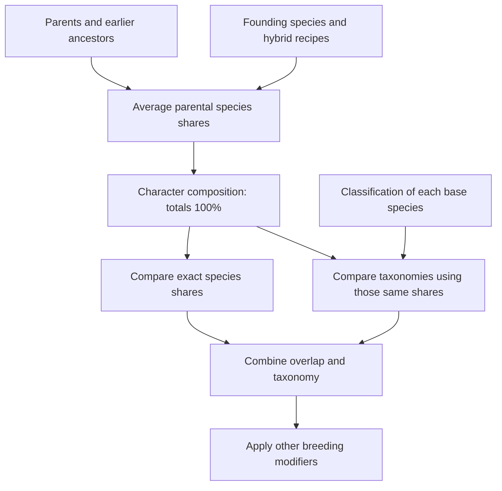
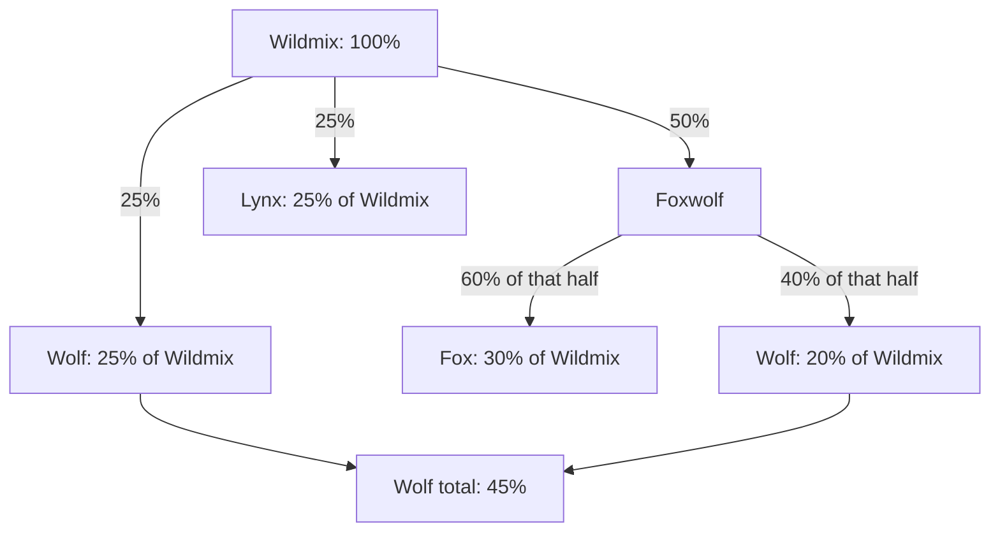
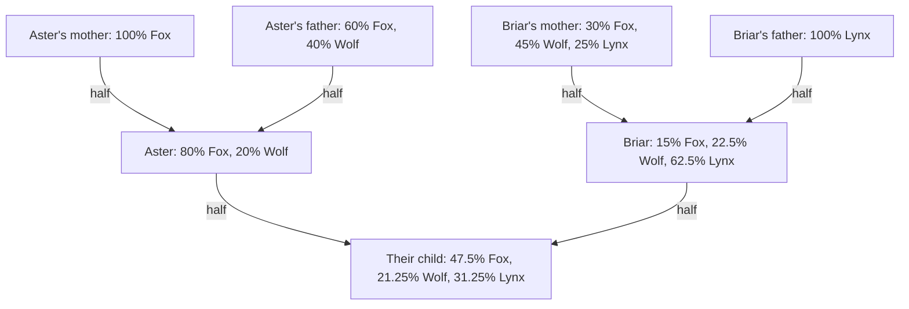
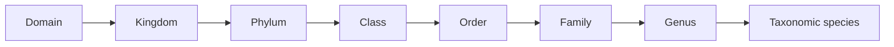
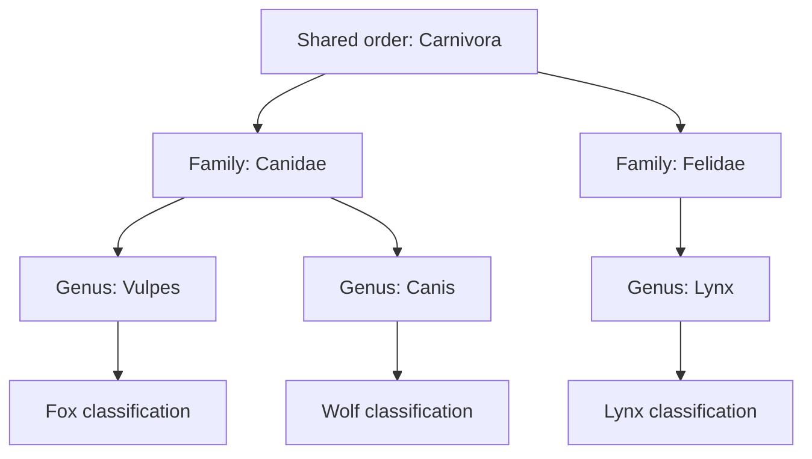
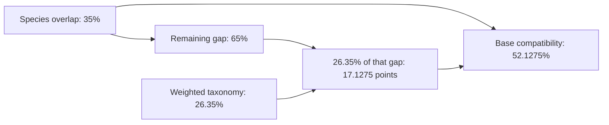
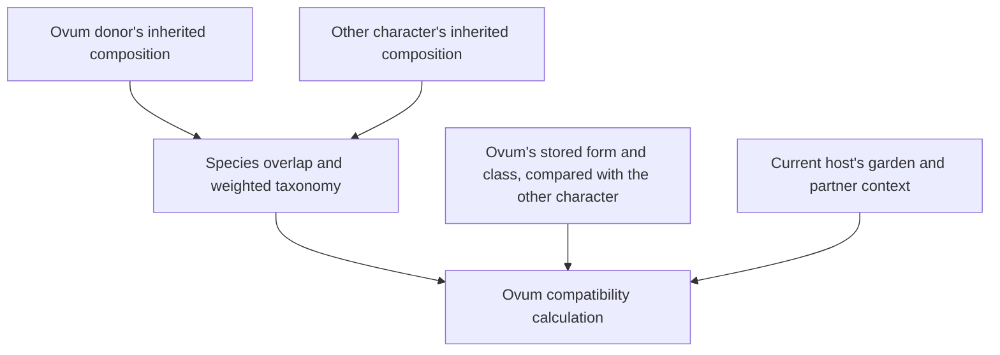

# From Ancestry to Species Percentages to Compatibility

## For end-users

### 1. What ancestry and taxonomy each tell us

**Ancestry determines how much of each species a character inherits. Taxonomy
determines how closely related those inherited species are when two characters
are compared.**

For example, a character can be **80% Fox and 20% Wolf**. Those numbers come
from their parents and the recipes of the species in their family tree.
If Fox and Wolf share a taxonomic family, that relationship helps determine
compatibility. It does not turn some of the Fox ancestry into additional Wolf
ancestry. The character remains 80% Fox and 20% Wolf.

There are three different kinds of percentage in this guide:

| Percentage | Question it answers | Example |
|---|---|---|
| Species composition | How much of this character comes from each species? | 80% Fox, 20% Wolf |
| Taxonomy compatibility | How closely related are the species represented in two characters, accounting for their shares? | A family match has a default score of 25% for that species pair |
| Combined compatibility | How strongly do species overlap and taxonomy support this pairing? | 35% overlap and 26.35% taxonomy combine to 52.1275% before other modifiers |

These are gameplay inheritance and compatibility rules, not a measurement of
real DNA or real-world reproductive probabilities. Examples below use the
default taxonomy scores and explicitly assigned example classifications.



The percentages stay attached to their species throughout this process.
Taxonomy supplies a comparison score for each pair of ingredients.

### 2. Start with the species recipe

A **base species** is a purebred species with no hybrid members to expand.
A hybrid recipe names member species and gives each a share. A member can
itself be a hybrid, so its share may need further expansion.

| Species kind | Definition | Example recipe |
|---|---|---|
| Purebred | Stands on its own | Fox = 100% Fox |
| True Hybrid | Has exactly two direct member species | Foxwolf = 60% Fox + 40% Wolf |
| Composition Hybrid | Has three or more direct member species | Wildmix = 50% Foxwolf + 25% Wolf + 25% Lynx |

These kinds describe the species recipe. An individual carrying a purebred
species label can still have mixed ancestry, as the next section explains.

#### Expanding a nested recipe

Wildmix contains 50% Foxwolf. Foxwolf is itself 60% Fox and 40% Wolf, so multiply
the percentages along that branch:

```text
Fox through Foxwolf  = 50% × 60% = 30%
Wolf through Foxwolf = 50% × 40% = 20%
Wolf directly       = 25%
Lynx directly       = 25%

Wildmix = 30% Fox + 45% Wolf + 25% Lynx
```



Wolf appears through two branches, so both contributions are added. Foxwolf
does not remain an additional slice after it has been expanded: its entire
50% is already accounted for by Fox and Wolf.

The same multiplication applies at every nesting level. All valid recipe
shares together account for 100% of the resulting composition.

### 3. Inherit the parents' actual compositions

For a character with two parents, the rule is:

```text
Child's share of a species
    = half of the mother's share + half of the father's share
```

Use each parent's **inherited composition**, including their ancestors. A
parent's selected species name alone does not determine what they pass on.

The calculation has these starting and fallback rules:

| Character situation | Source of the composition |
|---|---|
| Founding ancestor | The selected species recipe |
| Descendant with two parents | 50% of each parent's composition |
| Descendant with one known parent | 100% of the known parent's composition |
| Character without parents | The selected species recipe |

The one-parent rule is a fallback for incomplete parentage. It does not invent
an unknown second parent's species. An actual parent whose species has no
taxonomy is different: that parent's species contribution is still known and
still occupies its normal share.

Founding hybrids keep their declared recipes. A founder declared as 60% Fox and
40% Wolf remains 60/40 even if its origin story names one Fox and one Wolf
ancestor. Ordinary descendants inherit from that founder's 60/40 composition.

#### A two-character family tree

We will compare two characters, **Aster** and **Briar**:



The four parents shown above are founders using the recipes already described.
Aster's percentages are:

| Species | Half of mother's composition | Half of father's composition | Aster |
|---|---:|---:|---:|
| Fox | 50% | 30% | **80%** |
| Wolf | 0% | 20% | **20%** |
| Total | 50% | 50% | **100%** |

Briar's percentages are:

| Species | Half of mother's composition | Half of father's composition | Briar |
|---|---:|---:|---:|
| Fox | 15% | 0% | **15%** |
| Wolf | 22.5% | 0% | **22.5%** |
| Lynx | 12.5% | 50% | **62.5%** |
| Total | 50% | 50% | **100%** |

If Aster and Briar have a child, its Fox share is `(80% + 15%) ÷ 2 = 47.5%`.
The same calculation gives 21.25% Wolf and 31.25% Lynx.

**The parents' compatibility score does not change these inheritance shares.**
Compatibility affects breeding calculations; the child's composition follows
the parental averaging rule.

#### Why grandparents are not added a second time

Each parent's composition already includes the grandparents. A contribution
travelling through two successive parent-child links is multiplied by one-half
twice. A grandparent who is 60% Fox therefore contributes `25% × 60% = 15%`
Fox through that one path.

| Distance along one ancestral path | Fraction of that ancestor's composition reaching the character |
|---|---:|
| Parent | 50% |
| Grandparent | 25% |
| Great-grandparent | 12.5% |
| Four generations back | 6.25% |

These figures assume two known parents at each intervening generation. If the
same species arrives through several paths, add those contributions. If the same
ancestor occurs in several branches, each legitimate path contributes; their
already calculated composition can be reused without losing any shares.

The character's selected label also adds no extra share. Calling Aster “Fox,”
“Foxwolf,” or a composition species does not change the inherited 80/20 result.

### 4. Attach taxonomy to each inherited species

Purebred species can have their own classification. True hybrids and composition
hybrids derive taxonomy from the purebred species inside their expanded recipes.
A hybrid has no separate direct taxonomy that overrides its members.

The ranks run from broad to specific:



For our worked examples, assume the classifications below have been assigned.
Broader ranks are omitted from this diagram because the shared order is already
the closest match between the two families.



Fox and Wolf share a family but have different genera. Fox and Lynx, and Wolf
and Lynx, share the order but have different families.

**Use the closest shared rank once for each species pair.** A family match does
not also add the order, class, phylum, and kingdom scores.

| Closest shared rank | Default taxonomy score for the pair |
|---|---:|
| Taxonomic species | 90% |
| Genus | 50% |
| Family | 25% |
| Order | 10% |
| Class | 5% |
| Phylum | 2% |
| Kingdom | 1% |
| Domain only | 0% |
| No shared rank or no usable classification on either side | 0% |

For example, two different Fox species classified in the same genus would
receive a 50% pair score. Our Fox and Wolf receive 25%; our Fox and Lynx receive
10%. These are default game scores, not fractions of shared DNA.

#### Species identity and taxonomic species are different

Two separately defined game species can share the same taxonomic species
classification. They still occupy separate slices of a character's composition.
Their exact-species overlap is zero unless they share an actual base species,
but their taxonomy pair score can be 90%.

Matching display names alone does not establish either identity or a shared
classification. Two independently named “Fox” species need not be the same
species or share the same taxonomy.

Aster's 80% Fox and 20% Wolf could be described as 100% belonging to the shared
canid family. That is a grouping of existing shares, not another 100% to add to
the composition. Broader and narrower ranks describe overlapping groups.

### 5. First comparison: exact species overlap

Compare the amount of each base species that both characters carry. For each
species, take the **smaller** share, then add those shared amounts.

| Species | Aster | Briar | Shared amount |
|---|---:|---:|---:|
| Fox | 80% | 15% | 15% |
| Wolf | 20% | 22.5% | 20% |
| Lynx | 0% | 62.5% | 0% |
| Total | 100% | 100% | **35% species overlap** |

Aster's extra 65 percentage points of Fox cannot overlap with Fox that Briar
does not have. Briar's Lynx cannot contribute to exact-species overlap with
Aster, although its taxonomy can still matter in the next comparison.

Identical compositions have 100% overlap. Disjoint compositions have 0% overlap.
The overlap is symmetric: comparing Aster to Briar gives the same result as
comparing Briar to Aster.

### 6. Second comparison: taxonomy weighted by both compositions

Compare **every inherited species on one side with every inherited species on
the other side**. Multiply three values for each pair:

```text
Pair contribution = Aster's species share
                  × Briar's species share
                  × closest-shared-rank score
```

Use fractions while calculating: 80% is `0.80`, 22.5% is `0.225`, and 25% is
`0.25`. Convert the result back to a percentage at the end.

For our classifications, the pair scores are:

| Aster's species / Briar's species | Fox | Wolf | Lynx |
|---|---:|---:|---:|
| Fox | 90% — same taxonomic species | 25% — family | 10% — order |
| Wolf | 25% — family | 90% — same taxonomic species | 10% — order |

Now apply the actual ancestry shares:

| Pair | Calculation using fractions | Contribution to taxonomy score |
|---|---|---:|
| Fox × Fox | `0.80 × 0.15 × 0.90` | 10.8 percentage points |
| Fox × Wolf | `0.80 × 0.225 × 0.25` | 4.5 percentage points |
| Fox × Lynx | `0.80 × 0.625 × 0.10` | 5 percentage points |
| Wolf × Fox | `0.20 × 0.15 × 0.25` | 0.75 percentage points |
| Wolf × Wolf | `0.20 × 0.225 × 0.90` | 4.05 percentage points |
| Wolf × Lynx | `0.20 × 0.625 × 0.10` | 1.25 percentage points |
| Total | `0.2635` | **26.35% taxonomy compatibility** |

There are six pairs because Aster has two species and Briar has three.
Fox × Wolf and Wolf × Fox are both included: they involve different portions
of these characters. Swapping the characters reverses the table but preserves
the total.

One way to interpret the weighting is to choose an ingredient from each
character at random, with larger shares more likely to be chosen. The taxonomy
score is the average relatedness score of those pairs. A rare ancestral species
therefore has a proportionally smaller influence than a dominant one.

The taxonomy calculation includes pairs of the same species as well as pairs
of different species. It is a separate score over the complete compositions;
it is not calculated only on the slices left unmatched by species overlap.

### 7. Combine the two scores

Taxonomy fills a proportion of the compatibility gap left by species overlap:

```text
Base compatibility = overlap + (1 - overlap) × taxonomy
                   = 1 - (1 - overlap) × (1 - taxonomy)
```

For Aster and Briar:

```text
Species overlap             = 0.35
Remaining gap               = 1 - 0.35 = 0.65
Taxonomy                    = 0.2635
Taxonomy's addition to base = 0.65 × 0.2635 = 0.171275
Base compatibility          = 0.35 + 0.171275 = 0.521275
                            = 52.1275%
```



Adding 35% and 26.35% directly would give the wrong result. The taxonomy score
adds **17.1275 percentage points** here because it applies to the remaining gap.

If overlap is already 100%, taxonomy cannot raise it further. If overlap is
zero, base compatibility equals the taxonomy score. If taxonomy is zero, base
compatibility equals the overlap.

### 8. Compare some similar and different ancestries

All rows below show the base score before other breeding modifiers. Fox, Wolf,
and Lynx use the example classifications above.

| Character A | Character B | Species overlap | Taxonomy | Combined base |
|---|---|---:|---:|---:|
| 100% Fox | 100% Fox | 100% | 90% | **100%** |
| 100% Fox | 100% Wolf | 0% | 25% | **25%** |
| 100% Fox | 100% Lynx | 0% | 10% | **10%** |
| 80% Fox / 20% Wolf | 80% Fox / 20% Wolf | 100% | 69.2% | **100%** |
| 90% Fox / 10% Wolf | 10% Fox / 90% Wolf | 20% | 36.7% | **49.36%** |
| Aster: 80% Fox / 20% Wolf | Briar: 15% Fox / 22.5% Wolf / 62.5% Lynx | 35% | 26.35% | **52.1275%** |
| One game species | A different game species with the same taxonomic species classification | 0% | 90% | **90%** |
| 100% one species | 100% another species with no shared rank below domain | 0% | 0% | **0%** |

The inverse 90/10 blends share the same species list but overlap by only 20%.
Their taxonomy still helps because Fox and Wolf are related. Its calculation is
`0.09 × 0.90 + 0.81 × 0.25 + 0.01 × 0.25 + 0.09 × 0.90 = 0.367`.

Identical mixed characters can have less than 90% taxonomy compatibility because
the taxonomy comparison includes cross-species pairs inside their mixtures.
They still reach 100% base compatibility through exact composition overlap.

### 9. What if some ancestry has no taxonomy?

A species without a classification still counts toward inherited species
percentages and exact-species overlap. Its taxonomy pairs contribute zero.

Suppose **U** is a known base species that has not been classified:

| Character A | Character B | Species overlap | Taxonomy | Base |
|---|---|---:|---:|---:|
| 50% Fox / 50% U | 100% Wolf | 0% | `0.5 × 1 × 0.25 = 12.5%` | **12.5%** |
| 50% Fox / 50% U | 100% U | 50% | 0% | **50%** |
| 100% U | 100% U | 100% | 0% | **100%** |

The classified half in the first row stays at 50%; it is not enlarged to fill
the unclassified half. In the other rows, U is the **same actual species** on
both sides, so it provides exact-species overlap despite having no taxonomy.
Two different unclassified species would not match merely because both lack
classification.

### 10. How the base score becomes the breeding compatibility score

The ancestry and taxonomy assessment supplies the base. The complete calculation
can also include forced-species compatibility, garden and partner bonuses, and
form and class multipliers. Species percentages are not changed by these steps.

Garden and partner bonuses each close up to half of the remaining gap. Form and
class multipliers apply afterward. For example, starting with Aster and Briar's
52.1275% base, assume no forced-species boost and these illustrative modifiers:

| Step | Calculation | Result |
|---|---|---:|
| Base | Inherited species plus taxonomy | 52.1275% |
| Garden bonus of 20% | `1 - (1 - 0.521275) × 0.80` | 61.702% |
| Partner bonus of 10% | `1 - (1 - 0.61702) × 0.90` | 65.5318% |
| Form multiplier of 75% | `0.655318 × 0.75` | 49.14885% |
| Class multiplier of 80% | `0.4914885 × 0.80` | **39.31908%** |

The species overlap, taxonomy, and combined base are symmetric. A final breeding
calculation can differ with context or direction because it also uses those
other inputs. A compatibility percentage is also only one part of conception:
an available ovum, fertility and other reproductive conditions still matter.

#### An ovum uses its donor's ancestry

An ovum may be carried by someone other than its genetic donor. Its species
and taxonomy comparison uses the donor's complete composition and the other
character's complete composition.



Changing the carrier does not substitute the carrier's species percentages
for the donor's. The carrier supplies the relevant garden and relationship
context, while the ovum supplies its stored form and class.

When the carrier differs from the donor, conception also applies a separate
compatibility factor between the ovum and its carrier. That factor is multiplied
by the ovum's compatibility with the breeder. The carrier's biology therefore
still matters, while the donor remains the source of the ovum's ancestry.

Further reading: [Species Compatibility](species-compatibility.md),
[Creating a Species](species-creation.md), and
[Reproduction & Genetics Lifecycle](reproduction-and-genetics.md).

## For developers

### Calculation contract and source map

This guide describes the current implementation, including the shared ancestry
resolver. It does not propose new inheritance weights or a new taxonomy model.
The examples assume valid species graphs unless a fallback is explicitly named.

| Concern | Implementation | Contract |
|---|---|---|
| Resolve species recipes and character ancestry | [SpeciesCompositionHelper](../src/classes/helpers/SpeciesCompositionHelper.php) | Returns species references with fractional weights |
| Exact species overlap | [SpeciesAffinityHelper](../src/classes/helpers/SpeciesAffinityHelper.php) | Sum of the minimum weight for each shared species key |
| Taxonomy comparison | [TaxonomicHelper](../src/classes/helpers/TaxonomicHelper.php) | Weighted sum over every pair, using the nearest shared rank |
| Profile comparison | [ProfileHelper](../src/classes/helpers/ProfileHelper.php) | Resolves both profiles once for species and taxonomy |
| Ovum comparison | [OvumHelper](../src/classes/helpers/OvumHelper.php) | Resolves donor and target ancestry; preserves stored ovum traits and host context |
| Final score and step breakdown | [CompatibilityHelper](../src/classes/helpers/CompatibilityHelper.php) | Combines the inputs in the established order |

Let `C(p, s)` be profile `p`'s fraction of base species `s`, and `D(x, s)` be the
fraction obtained by expanding species recipe `x`. For valid compositions:

```text
Purebred x:       D(x, s) = 1 if s is x, otherwise 0
Hybrid x:         D(x, s) = sum(memberWeight × D(memberSpecies, s))
Founder p:        C(p, s) = D(selectedSpecies(p), s)
Two-parent p:     C(p, s) = 0.5 × C(parentA, s) + 0.5 × C(parentB, s)
One-parent p:     C(p, s) = C(knownParent, s)
Parentless p:     C(p, s) = D(selectedSpecies(p), s)

sum over s of C(p, s) = 1
```

`ProfileModelImpl::getBirth() === null` marks a founder for this walk, even when
gene links exist. `geneA` and `geneB` are consulted for non-founders. A gene link
to the profile itself is treated as absent. Descendant selected labels add no
extra ancestry; `SpeciesAffinityHelper::SELF_WEIGHT` remains `0.0`.

For profiles A and B, with `R(i, j)` the nearest-shared-rank score:

```text
L = sum over s of min(C(A, s), C(B, s))
T = sum over all i, j of C(A, i) × C(B, j) × R(i, j)
B = 1 - (1 - L) × (1 - T)
```

`L` and `T` are clamped to `[0, 1]` by their scorers. Species identity uses
persisted species IDs, with negative object IDs for transient species. Taxonomy
identity uses persisted taxonomy IDs or object identity for new nodes; neither
comparison merges by display name. Multiple game species with the same taxonomy
can be aggregated for the taxonomy calculation without merging their species
overlap keys.

The full calculation uses fractions throughout:

```text
F = forced-species compatibility input
G = garden bonus clamped to [0, 0.5]
P = partner bonus clamped to [0, 0.5]
M = form compatibility multiplier
K = class compatibility multiplier

afterForced = max(B, (B + F) / 2)
final = (1 - (1 - afterForced) × (1 - G) × (1 - P)) × M × K
```

Nonfinite garden and partner inputs contribute zero. Actual rank scores come
from application settings via `TaxonomicHelper::rankCompatibility()`; the table
in the reader section lists their defaults. Production callers pass the setting
resolver. A nearest shared rank selects its configured value even if another,
broader rank has a larger configured value.

### Missing data, malformed graphs, and precision

- Missing taxonomy does not remove a species from the ancestry vector. Its
  taxonomy contribution is zero, with no redistribution of its share.
- Positive finite hybrid weights are normalized at each recipe level. Invalid,
  zero, negative, and nonfinite weights are excluded. Scaling before summation
  prevents large finite weights from overflowing the normalization denominator.
- A wholly invalid recipe, cyclic species branch, or missing species leaf is
  retained as an opaque species share. Its taxonomy is zero; the other shares
  are not inflated. This fallback does not reconstruct the missing ancestry.
- A profile cycle terminates on the revisited profile's selected species recipe.
  That is a termination fallback for malformed parentage, not an alternative
  rule for valid family trees.
- Taxonomy traversal stops at malformed or missing rank links. Obsolete direct
  taxonomy on a hybrid is ignored. No branch is repaired or deleted by scoring.
- Calculations use PHP floating-point fractions, retaining tiny positive shares
  without a deliberate ancestry cutoff. Percentages are exact according to the
  inheritance model subject to floating-point precision; display rounding is
  not an input to later calculations. There is no random gene sampling here.

### Reuse and persistence

Each comparison creates a resolver with local memoization for profiles and
species. A shared acyclic ancestor is expanded once, and every incoming path
still applies its own weight. Cycle-dependent results are not memoized because
they can differ by entry path. A new calculation sees later edits.

There is currently no persisted character-composition table. Lazy Doctrine
associations can require database reads on an initial comparison; already
hydrated entities can be reused afterward within the same managed graph.
That reuse does not promise zero reads on the next HTTP request.

The persisted ancestry regression measured 19 cold ancestry/taxonomy reads and
zero additional reads across ten hydrated repeats for its fixture. That is not
a bound on production pedigrees. Persistent composition storage would need
profiling evidence, a backfill, and invalidation for parent changes, descendant
dependencies, and species recipe changes. Taxonomy classifications and rank
settings would still need to be applied to the resolved species shares.

### Verification and executable examples

The numeric examples are exercised against production helpers without starting
the application in
[SpeciesAncestryWorkedExamplesTest](../tests/unit/SpeciesAncestryWorkedExamplesTest.php).
Additional coverage includes:

| Test | Coverage |
|---|---|
| [SpeciesCompositionHelperTest](../tests/unit/SpeciesCompositionHelperTest.php) | Nested recipes, parent averaging, shared ancestors, tiny shares, identity collisions, cycles, malformed weights, and fresh calculations after edits |
| [ProfileTaxonomicCompatibilityTest](../tests/unit/ProfileTaxonomicCompatibilityTest.php) | Inherited taxonomy for all selected species kinds, unknown shares, founder recipes, and configured rank values |
| [HybridTaxonomicCompatibilityTest](../tests/unit/HybridTaxonomicCompatibilityTest.php) | Weighted species recipes, cycle handling, and ignored obsolete hybrid taxonomy |
| [InheritedSpeciesCompositionDrivesProfileAndOvumCompatibilityTest](../tests/e2e/cases/InheritedSpeciesCompositionDrivesProfileAndOvumCompatibilityTest.php) | Persisted ancestry, both participants' shares, donor versus host, eligibility, and database-read reuse |

Run the unit suite with `composer test:unit` and the persistence scenarios with
`composer test:e2e`. `composer test` runs the complete unit, integration, and
end-to-end gate.
