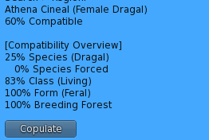

Your species match uses your inherited composition and shared taxonomy. A species label alone does not establish a fixed match percentage. See [Species compatibility](/system-guide/species-compatibility) for the calculation and [Ancestry and taxonomy](/system-guide/ancestry-and-taxonomy) for worked examples.

***

### Species forced

Species Forced is gained through consecutive days of receiving that species’ semen by copulation or insemination.\
The required number of days is:

**min(Growth Period, Ovulation Cycle)**

Completing that full streak results in **100% forced compatibility** with that species.

***

<a id="class--form-compatibility"></a>

### Class and form compatibility

Class and form modify the running score after species overlap, taxonomy, forced compatibility, garden, and partner bonuses, using their complexity values.\
The compatibility factor uses the lower value divided by the higher value for both Class and Form:

```text
(class_low / class_high) * (form_low / form_high)
```

***

#### Class complexity

* Human — 1.0
* Demon — 1.2
* Daemon — 1.5
* Deity — 2.0
* Synth — 100.0
* Digital — 500.0

#### Form complexity

* Human — 1.0
* Feral — 0.8
* Anthro — 0.9
* Taur — 1.1
* Shift — 1.2
* Monster — 1.3

***

### Example

Two characters have identical inherited compositions and both are Feral.\
One has a Human class (1.0) and the other has a Daemon class (1.5).

With no other boosts, their final compatibility is:

```text
100 * (1.0 / 1.5) * (0.8 / 0.8) = 66.67%
```

***

<a id="breeding-forests--partners"></a>

### Breeding forests and partners

Gardens and established partnerships can each close up to **50% of the remaining compatibility gap**, before form and class multipliers apply.

Starting from a 20% score before bonuses, one full bonus gives 60%, and two full bonuses give 80%. With a later class multiplier of `1 / 1.5` and matching forms, that 80% becomes approximately 53.33%.

See [Garden and partner boosts](/system-guide/species-compatibility#9-garden-and-partner-boosts). The older illustration below is retained as a historical reference; use the current calculation above.

<br />


