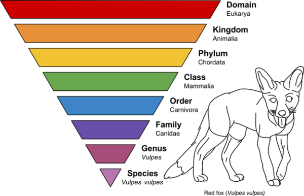

Your compatibility uses inherited species overlap and shared taxonomy. Hybrids can match other species through their inherited shares and classifications; they are not restricted to their own named species.

Read [How species compatibility works](/system-guide/species-compatibility) for the current rules, or follow the [ancestry and taxonomy worked example](/system-guide/ancestry-and-taxonomy).

The historical illustration below shows a taxonomy hierarchy. Current scores use the closest shared rank, followed by the other breeding modifiers.

Kingdom

